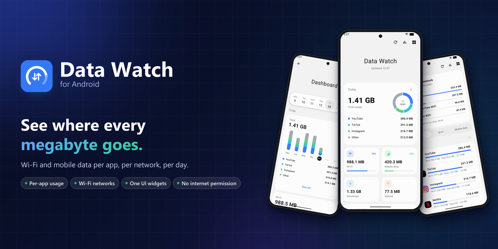
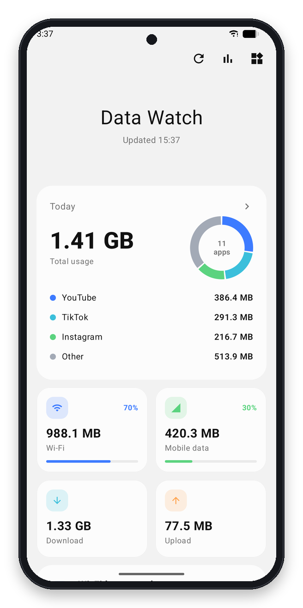
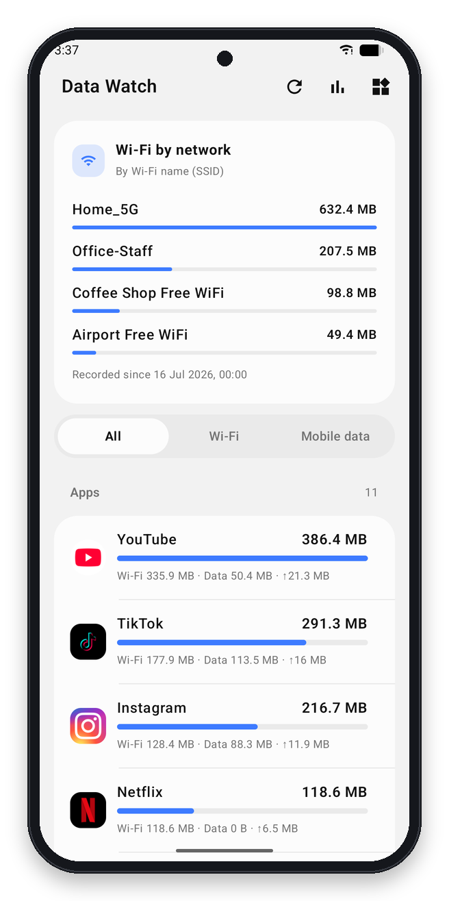
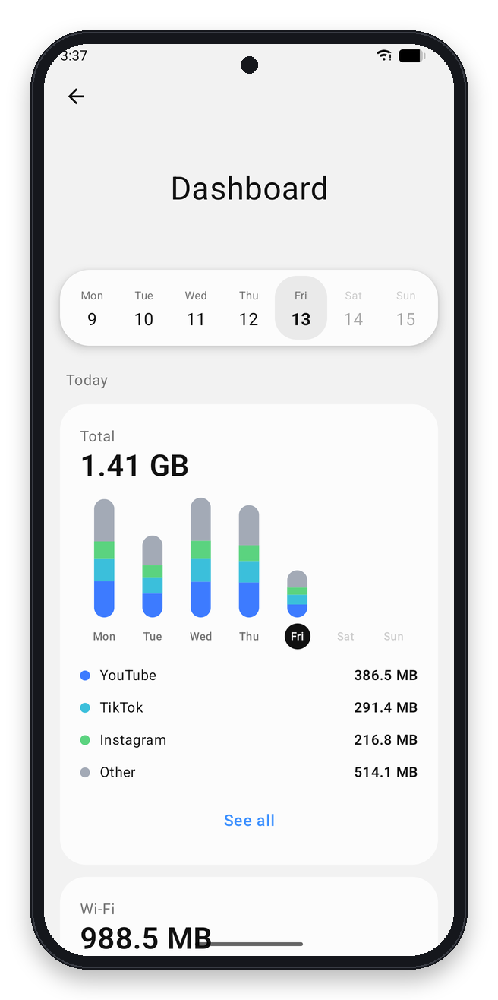
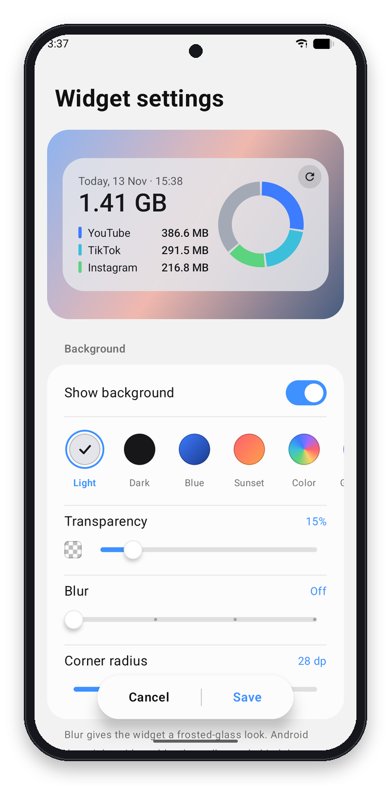

<div align="center">

<picture><source media="(prefers-color-scheme: dark)" srcset="docs/banner-dark.png"></picture>

# Data Watch

**See where every megabyte goes.** Wi-Fi and mobile data usage per app and per Wi-Fi network, right on your home screen.

[](https://github.com/Muh-Asad-Habib/data-usage-widget/releases/latest)
[](https://github.com/Muh-Asad-Habib/data-usage-widget/releases)


[](LICENSE)

<a href="https://github.com/Muh-Asad-Habib/data-usage-widget/releases/download/v1.2.2/DataWatch-v1.2.2.apk"></a>

</div>

---

## Why Data Watch?

Android already tracks data usage, but it is buried deep in Settings and there is no widget for it. Data Watch brings those numbers to the surface: how much you used today, which apps used it, on which Wi-Fi network, and which apps upload data while you are not using them.

<table>
<tr>
<td width="33%" valign="top">

### At a glance
Today's total, Wi-Fi vs. mobile data, download vs. upload and top apps on one clean screen.

</td>
<td width="33%" valign="top">

### Per app, per network
Every app with Wi-Fi, mobile and upload split, plus usage for each Wi-Fi name (SSID) you connected to.

</td>
<td width="33%" valign="top">

### Spot silent uploads
Apps that send data in the background are highlighted, a useful hint when checking for spyware.

</td>
</tr>
</table>

## Screenshots

<div align="center">

<picture><source media="(prefers-color-scheme: dark)" srcset="docs/framed/home-dark.png"></picture> <picture><source media="(prefers-color-scheme: dark)" srcset="docs/framed/apps-dark.png"></picture> <picture><source media="(prefers-color-scheme: dark)" srcset="docs/framed/dashboard-dark.png"></picture> <picture><source media="(prefers-color-scheme: dark)" srcset="docs/framed/widget-settings-dark.png"></picture>

<sub>Screenshots follow your GitHub theme: switch to dark mode to see the dark theme.</sub>

</div>

## Features

<table>
<tr>
<td width="55%" valign="top">

### Dashboard
- Tap the total on Home to open the **Dashboard**
- Swipe through weeks and tap any day
- Last 7 days, this month, last month or any custom date range
- Weekly stacked charts for total, Wi-Fi and mobile data, with top apps per day

### Apps and networks
- Per-app usage with foreground and background split
- Filter by All, Wi-Fi or Mobile data
- Usage per Wi-Fi network (SSID), recorded on the device
- Background uploads list to catch apps that quietly send data

</td>
<td width="45%" align="center">
<picture><source media="(prefers-color-scheme: dark)" srcset="docs/framed/dashboard-dark.png"></picture>
</td>
</tr>
<tr>
<td width="55%" valign="top">

### Widgets that feel native
- Sizes 2x1, 2x2, 4x1 and 4x2
- One UI style settings screen with a live preview
- Pick period, network and what to show
- Background presets, custom color, gradient or your own image
- Transparency, frosted blur and corner radius

### Light, fast and private
- About 1.4 MB, no background services eating RAM
- **No internet permission**: nothing ever leaves your phone
- Light and dark theme, follows the system language

</td>
<td width="45%" align="center">
<picture><source media="(prefers-color-scheme: dark)" srcset="docs/framed/widget-settings-dark.png"></picture>
</td>
</tr>
</table>

## Install

1. [Download the APK](https://github.com/Muh-Asad-Habib/data-usage-widget/releases/download/v1.2.2/DataWatch-v1.2.2.apk) and open it (allow "Install unknown apps").
2. Open **Data Watch** and grant **Usage access**.
3. Optional: allow **Location** to show Wi-Fi names (Android needs it to read the SSID).
4. Long-press your home screen, tap **Widgets** and add **Data Watch**.

**Requirements:** Android 8.0 or newer (minSdk 26).

## FAQ

<details>
<summary><b>Can this tell me if I am being spied on?</b></summary>

It cannot prove it, but it gives you strong hints. Spyware has to send what it collects somewhere, so look at the **Background uploads** section: an app you rarely open that uploads a lot in the background is worth checking or uninstalling.
</details>

<details>
<summary><b>Where does the data come from?</b></summary>

From Android's own network statistics (the same source as Settings > Connections > Data usage). Data Watch only reads and displays it.
</details>

<details>
<summary><b>Why does it need Location?</b></summary>

Android only reveals the Wi-Fi name (SSID) to apps with Location permission. It is optional; everything else works without it.
</details>

<details>
<summary><b>Does it drain the battery?</b></summary>

No. There is no always-running service. Widgets refresh on a schedule and when you tap refresh.
</details>

## Build from source

```bash
git clone https://github.com/Muh-Asad-Habib/data-usage-widget.git
cd data-usage-widget
./gradlew assembleRelease
```

Built with Kotlin, Jetpack Compose and RemoteViews.

## License

[MIT](LICENSE)